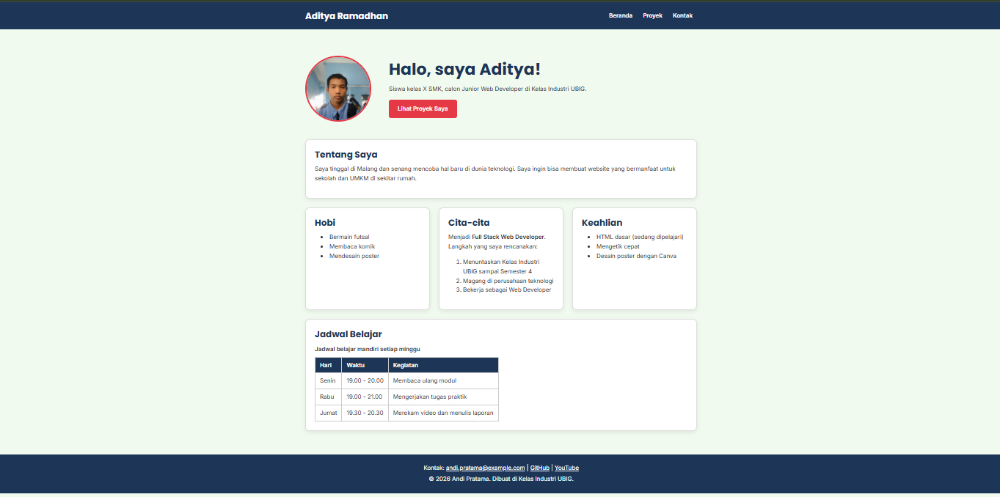

# Portofolio Aditya

Website portofolio pribadi yang saya buat di Kelas Industri UBIG (Paket 1, Minggu 01 sampai 05). Website ini tampil rapi di ponsel, tablet, dan laptop.

## Tampilan 

 

## Fitur 

- halaman **Beranda** berisi profil, hobi, cita-cita, keahlian, dan - jadwal belajar- Halaman 
- halaman **Proyek** berisi daftar proyek dalam bentuk kartu- Halaman - halaman **Kontak** berisi form untuk menghubungi saya
- Tampilan responsif dengan Flexbox dan *media query*

## Teknologi 

- HTML5
- CSS3 (Flexbox dan media query)
- Git dan GitHub

## Tautan- Halaman

- Website: https://porotfolio-aditya.vercel.app/
- Dibuat oleh: Aditya Ramadhan, SMKS Brantas Karangkates
